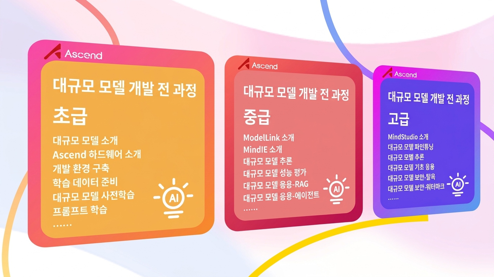
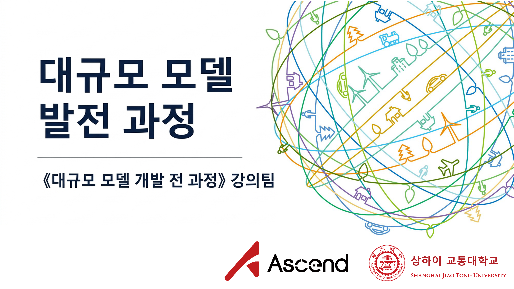
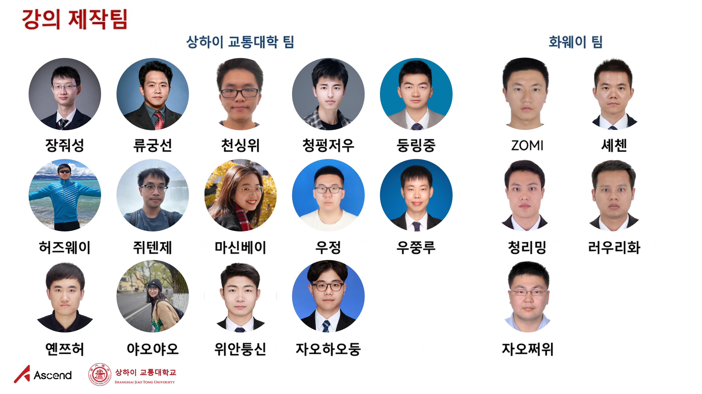
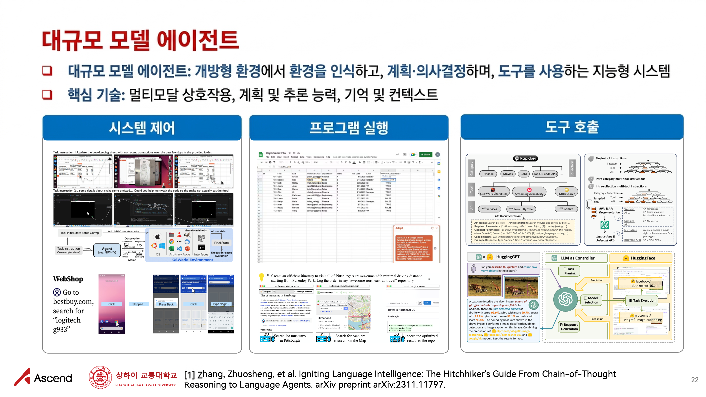

<h1 align="center"><밑바닥부터 시작하는 대규모 모델(Dive into LLMs)> 시리즈 프로그래밍 실습 튜토리얼</h1>

  	
  
  
   	
  	
    
     

  <a href="#프로젝트-동기">프로젝트 동기</a> /
  <a href="#튜토리얼-목차">튜토리얼 목차</a> /
  <a href="#기여자-목록">기여자 목록</a>

## 💡 Updates

2025/06/06  많은 분들의 관심과 적극적인 피드백에 감사드립니다! 본 튜토리얼을 다음 두 가지 측면에서 업데이트했습니다:

- [x] 자체 생태계 기반 <대규모 모델 개발 전 과정> 공익 튜토리얼(PPT, 실습 매뉴얼 및 동영상 포함) 출시 — 화웨이 어센드(Ascend) 커뮤니티의 지원에 특별히 감사드립니다!
- [x] 기존 시리즈 프로그래밍 실습 튜토리얼을 바탕으로 콘텐츠를 업데이트하고 새로운 주제(수학적 추론, GUI 에이전트, 대규모 모델 정렬, 스테가노그래피 등)를 추가했습니다!

## 🎯 프로젝트 동기

<밑바닥부터 시작하는 대규모 모델(Dive into LLMs)> 시리즈 프로그래밍 실습 튜토리얼은 상하이 교통대학의 <자연어 처리 최첨단 기술>(NIS8021), <인공지능 보안 기술> 과정(NIS3353) 강의 자료에서 확장되었으며(담당 교원: [장줘성(Zhuosheng Zhang)](https://bcmi.sjtu.edu.cn/home/zhangzs/)), 대규모 모델 관련 입문 프로그래밍 참고 자료를 제공하는 것을 목표로 합니다. 본 튜토리얼은 공익 목적의 완전 무료 자료입니다. 간단한 실습을 통해 학생들이 대규모 모델에 빠르게 입문하고, 캡스톤 디자인이나 학술 연구를 더욱 원활하게 수행할 수 있도록 돕습니다.

## 📚 튜토리얼 목차

| 튜토리얼 내용 | 소개 | 링크 |
| ---------------- | ------------------------------------------------------------ | ------------------------------------------------------------ |
| 파인튜닝 및 배포 | 사전 학습 모델 파인튜닝 및 배포 가이드: 특정 작업에서 사전 학습 모델의 성능을 높이고 싶으신가요? 적절한 사전 학습 모델을 선택해 특정 작업에 맞게 파인튜닝하고, 파인튜닝된 모델을 사용하기 편리한 데모(Demo)로 배포해 봅시다! | [[강의자료](./documents/chapter1/dive-into-llm.pdf)] [[튜토리얼](./documents/chapter1/README.md)] [[스크립트](./documents/chapter1/dive-tuning.ipynb)] |
| 프롬프트 학습과 사고의 사슬(CoT) | 대규모 모델 API 호출 및 추론 가이드: "AI가 온라인으로 격려를 구한다고요? 일부 질문에 대한 대규모 모델의 답변은 놀라울 정도로 엉뚱할 때가 있지만, 사실 한마디의 '격려'가 필요한 것일지도 모릅니다." | [[강의자료](./documents/chapter2/dive-into-prompting.pdf)] [[튜토리얼](./documents/chapter2/README.md)] [[스크립트](./documents/chapter2/dive-prompting.ipynb)] |
| 지식 편집 | 언어 모델 편집 방법 및 도구: 특정 지식에 대한 언어 모델의 기억을 조작하고 싶으신가요? 적절한 편집 방법을 선택하여 특정 지식을 편집하고, 편집된 모델을 검증해 봅시다! | [[강의자료](./documents/chapter3/dive_edit_0410.pdf)] [[튜토리얼](./documents/chapter3/README.md)] [[스크립트](./documents/chapter3/dive_edit.ipynb)] |
| 수학적 추론 | 대규모 모델에게 수학적 추론을 어떻게 가르칠 수 있을까요? 미니 R1 모델을 빠르게 지식 증류(Distillation)해 봅시다! | [[강의자료](./documents/chapter4/math.pdf)] [[튜토리얼](./documents/chapter4/README.md)] [[스크립트](./documents/chapter4/sft_math.ipynb)] |
| 모델 워터마킹 | 언어 모델의 텍스트 워터마킹: 언어 모델이 생성한 콘텐츠에 사람의 눈에는 보이지 않는 워터마크 삽입하기 | [[강의자료](./documents/chapter5/watermark.pdf)] [[튜토리얼](./documents/chapter5/README.md)] [[스크립트](./documents/chapter5/watermark.ipynb)] |
| 탈옥 공격(Jailbreak) | 더 나은 보안을 갖추려면 먼저 공격 방법을 배워야 합니다. 탈옥 공격이 어떻게 대규모 모델의 입을 열게 하는지 알아봅시다! | [[강의자료](./documents/chapter6/dive-Jailbreak.pdf)] [[튜토리얼](./documents/chapter6/README.md)] [[스크립트](./documents/chapter6/dive-jailbreak.ipynb)] |
| 대규모 모델 스테가노그래피 | "보이지 않는 잉크"! 대규모 모델이 유창하게 답변하는 동시에 '우리 편'만 식별할 수 있는 비밀 정보를 몰래 담아 보내게 하고 싶으신가요? 대규모 모델 스테가노그래피가 알려드립니다! | [[강의자료](./documents/chapter7/stega.pdf)] [[튜토리얼](./documents/chapter7/README.md)] [[스크립트](./documents/chapter7/llm_stega.ipynb)] |
| 멀티모달 모델 | 현실 세계를 더욱 충실히 시뮬레이션할 수 있는 멀티모달 대규모 언어 모델(MLLM)은 어떻게 더 강력한 멀티모달 이해 및 생성 능력을 구현할까요? 멀티모달 대규모 언어 모델은 AGI 실현에 도움을 줄 수 있을까요? | [[강의자료](./documents/chapter8/mllms.pdf)] [[튜토리얼](./documents/chapter8/README.md)] [[스크립트](./documents/chapter8/mllms.ipynb)] |
| GUI 에이전트 | 손 하나 까딱하지 않고 편하게 일상을 누리고 싶으신가요? AI 에이전트가 여러분 대신 배달 음식을 주문하고, 메시지에 답장하고, 쇼핑 가격 비교를 하도록 함께 만들어 봅시다! | [[강의자료](./documents/chapter9/GUIagent.pdf)] [[튜토리얼](./documents/chapter9/README.md)] [[스크립트](./documents/chapter9/GUIagent.ipynb)] |
| 에이전트 보안 | 대규모 모델 에이전트는 미래 운영체제(OS)로의 여정을 시작했습니다. 그렇다면 개방형 에이전트 환경에서 대규모 모델은 보안 위험과 위협을 인식할 수 있을까요? | [[강의자료](./documents/chapter10/dive-into-safety.pdf)] [[튜토리얼](./documents/chapter10/README.md)] [[스크립트](./documents/chapter10/agent.ipynb)] |
| RLHF 안전 정렬 | PPO 기반 RLHF 실험 가이드: 이 튜토리얼은 "매우 위험"합니다. 읽은 후 여러분의 대규모 모델이 비웃고 있지 않은지 확인해 보세요. | [[강의자료](./documents/chapter11/RLHF.pdf)] [[튜토리얼](./documents/chapter11/README.md)] [[스크립트](./documents/chapter11/RLHF.ipynb)] |

## 🔥 신규 출시: <대규모 모델 개발 전 과정>

- **✨ 화웨이 어센드(Ascend)와 공동으로 선보이는 <대규모 모델 개발 전 과정> 공익 튜토리얼이 정식 출시되었습니다! 최첨단 기술 + 코드 실습으로 AI 대규모 모델을 직접 다뤄보세요 ✨**: 

  기존 <밑바닥부터 시작하는 대규모 모델> 시리즈 튜토리얼을 바탕으로 화웨이와 협력하여 <대규모 모델 개발 전 과정> 시리즈 강의를 개발했습니다. 본 시리즈 튜토리얼은 어센드(Ascend) 기반 하드웨어 및 소프트웨어로 개발되었으며 PPT, 실습 매뉴얼, 동영상 등의 교육 자료 형태를 포괄합니다. 초급, 중급, 고급 시리즈로 구성되어 다양한 대규모 모델 실습 수요에 부응하며, 최첨단 기술을 코드 실습 방식으로 풀어내어 관련 연구자와 개발자가 기초부터 심화까지 빠르게 익히고 어센드 지원 모델 활용 및 신규 모델 마이그레이션·튜닝의 전 과정 개발 가이드를 제공합니다.
  
- **🚀 어센드(Ascend) 커뮤니티에서 <대규모 모델 개발 전 과정> 시리즈 강의 탐색하기**: 
  
  👉<[대규모 모델 개발 학습 전용관](https://www.hiascend.com/edu/growth/lm-development#classification-floor-1)>@ 어센드(Ascend) 커뮤니티 👈 
  
- **✨ 강의 콘텐츠 미리보기 ✨**

  <!-- 
  
  
   -->

  
  
  
  

## 🙏 면책 조항

본 튜토리얼의 모든 내용은 기여자들의 개인적인 경험, 인터넷 데이터, 일상적인 연구 활동에서 축적된 내용만을 바탕으로 작성되었습니다. 모든 기법은 참고용일 뿐이며 100% 정확성을 보장하지 않습니다. 문제가 있을 경우 언제든지 Issue나 PR을 제출해 주세요. 또한 본 프로젝트에 사용된 배지(badge)는 인터넷에서 가져온 것으로, 이미지 저작권을 침해한 경우 연락해 주시면 즉시 삭제하겠습니다. 감사합니다.

## 🤝 기여 환영

본 튜토리얼은 현재 진행 중인 프로젝트이므로 미흡한 점이 있을 수 있습니다. 어떠한 형태의 PR 및 Issue 토론도 환영합니다.

## ❤️ 기여자 목록

본 프로젝트를 지원하고 기여해 주신 아래 교수님들과 학생 여러분께 감사드립니다:

**<밑바닥부터 시작하는 대규모 모델> 시리즈 튜토리얼 개발팀**:

- 상하이 교통대학: [장줘성(Zhuosheng Zhang)](https://bcmi.sjtu.edu.cn/home/zhangzs/), [위안퉁신(Tongxin Yuan)](https://github.com/Lordog), [마신베이(Xinbei Ma)](https://scholar.google.com/citations?user=LpUi3EgAAAAJ&hl=en&oi=ao), [허즈웨이(Zhiwei He)](https://zwhe99.github.io), [두웨이(Wei Du)](https://scholar.google.com/citations?user=tFYUBLkAAAAJ&hl=en), [자오하오둥(Haodong Zhao)](https://dongdongzhaoup.github.io/), [우쭝루(Zongru Wu)](https://zrw00.github.io/), [우정(Zheng Wu)](https://wuzheng02.github.io/), [둥링중(Lingzhong Dong)](https://github.com/LZ-Dong), [장위룽(Yulong Zhang)](https://aslan-yulong.github.io/)

- 싱가포르 국립대학: [페이하오(Hao Fei)](http://haofei.vip/)

**<대규모 모델 개발 전 과정> 시리즈 튜토리얼 개발팀:**

- 상하이 교통대학: [장줘성(Zhuosheng Zhang)](https://bcmi.sjtu.edu.cn/home/zhangzs/), [류궁선(Gongshen Liu)](https://infosec.sjtu.edu.cn/DirectoryDetail.aspx?id=75), [천싱위(Xingyu Chen)](https://scholar.google.com/citations?user=d-dNtjrMJ5YC&hl=en), [청펑저우(Pengzhou Cheng)](https://scholar.google.com/citations?user=qxnwzDUAAAAJ&hl=en), [둥링중(Lingzhong Dong)](https://github.com/LZ-Dong), [허즈웨이(Zhiwei He)](https://zwhe99.github.io), [쥐톈제(Tianjie Ju)](https://scholar.google.com/citations?user=f8PPcnoAAAAJ&hl=en), [마신베이(Xinbei Ma)](https://scholar.google.com/citations?user=LpUi3EgAAAAJ&hl=en&oi=ao), [우정(Zheng Wu)](https://scholar.google.com/citations?hl=en&user=qBM1UbUAAAAJ&view_op=list_works&gmla=AIfU4H6PG9JyjRub6BYIIZ4isQE7MBAM3Eoec6OJfX4z_8-pOE8bI1Wgdo3XL5qOZWR3U-h-lIP2q0zXt5gzyFKMSg7MNnBBWLv5d1IVG30UANczTP0), [우쭝루(Zongru Wu)](https://zrw00.github.io/), [옌쯔허(Zihe Yan)](https://scholar.google.com/citations?user=O2YfSHoAAAAJ&hl=en), [야오야오(Yao Yao)](https://scholar.google.com/citations?user=tLMP3IkAAAAJ), [위안퉁신(Tongxin Yuan)](https://github.com/Lordog), [자오하오둥(Haodong Zhao)](https://dongdongzhaoup.github.io/);

- 화웨이 어센드(Ascend) 커뮤니티: ZOMI, 셰첸(Qian Xie), 청리밍(Liming Cheng), 러우리화(Lihua Lou), 자오쩌위(Zeyu Jiao)

## 🌟 Star History

