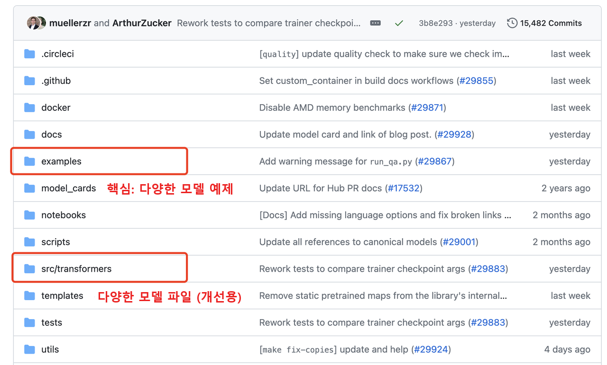

# 사전 학습 언어 모델 파인튜닝 및 배포

> 들어가며: 이 장에서는 사전 학습 모델의 파인튜닝(Fine-tuning)을 소개합니다.
특정 작업에서 사전 학습 모델의 성능을 향상시키고 싶으신가요? 적절한 사전 학습 모델을 선택하여 특정 작업에 맞게 파인튜닝하고, 파인튜닝된 모델을 사용하기 편리한 데모(Demo)로 배포해 봅시다!
## 본 튜토리얼의 목표:
1. Transformers 툴킷 사용법 익히기
2. 사전 학습 모델의 파인튜닝 및 추론 마스터하기 (모듈 분리형 커스텀 버전 & 기본 통합 버전)
3. Gradio Spaces를 활용한 데모 배포 마스터하기
4. 다양한 유형의 사전 학습 모델 선택 기준 및 응용 시나리오 이해하기
## 본 튜토리얼의 내용:
### 1. 사전 준비:
#### 1.1 툴킷 알아보기: Transformers
https://github.com/huggingface/transformers

> 🤗 Transformers는 최첨단 사전 학습 모델을 쉽게 다운로드하고 학습시킬 수 있는 API와 도구를 제공합니다. 사전 학습 모델을 사용하면 연산 비용과 탄소 배출을 줄일 수 있으며, 처음부터 모델을 학습시키는 데 필요한 시간과 자원을 절약할 수 있습니다. 이러한 모델은 다양한 모달리티의 일반적인 작업을 지원합니다. 예를 들면 다음과 같습니다:
📝 자연어 처리: 텍스트 분류, 개체명 인식(NER), 질의응답(QA), 언어 모델링, 요약, 번역, 객관식 선택 및 텍스트 생성.
🖼️ 컴퓨터 비전: 이미지 분류, 객체 탐지 및 시맨틱 세그멘테이션(의미론적 분할).
🗣️ 오디오: 자동 음성 인식(ASR) 및 오디오 분류.
🐙 멀티모달: 테이블 질의응답, 광학 문자 인식(OCR), 스캔 문서에서 정보 추출, 비디오 분류 및 시각적 질의응답(VQA).

상세 문서: https://huggingface.co/docs/transformers/index (영문 공식 문서: https://huggingface.co/docs/transformers/main/en/index)



#### 1.2 환경 설치: 텍스트 분류(예: 가짜 뉴스 탐지)를 예시로
1. 텍스트 분류 예제 저장소에 접속하여 readme를 참고해 주요 파라미터를 파악하고, requirements.txt와 run_classification.py를 다운로드합니다.

https://github.com/huggingface/transformers/tree/v4.40.0/examples/pytorch/text-classification

2. 환경 설치:
- 1. conda를 통해 새로운 가상환경 생성: conda create -n llm python=3.9
- 2. 가상환경 활성화: conda activate llm
- 3. pip install transformers
- 4. requirements.txt에서 자동으로 설치되는 torch 항목을 제거한 후, pip install -r requirements.txt 실행

> 기본 PyPI 환경에서 바로 설치할 수 있습니다: `pip install [Packages]` (네트워크 환경에 따라 필요시 국내외 미러 서버를 지정할 수 있습니다).

> 미러 서버를 사용해 pytorch를 설치하면 자동으로 pytorch CPU 버전이 선택되어 GPU를 실행할 수 없으므로 다음과 같이 설치합니다 —

- 5. conda install pytorch

> PyTorch 공식 설치 가이드: https://pytorch.org/get-started/locally/ (Conda 채널 관리: https://docs.conda.io/projects/conda/en/latest/user-guide/tasks/manage-channels.html)

3. 데이터 준비: Kaggle의 가짜 트윗 데이터셋을 예시로 사용합니다: https://www.kaggle.com/c/nlp-getting-started/data

#### 1.3 사전 구성된 프로젝트 패키지 (데모 코드 및 데이터)
(1) 모듈 분리형 커스텀 버전 (핵심 모듈이 분리되어 있어 이해하기 쉽고, 데이터 로딩, 모델 구조, 평가 지표 등을 자유롭게 커스터마이징 가능)

[TextClassificationCustom 다운로드 링크 (Google Drive)](https://drive.google.com/file/d/12cVWpYbhKVLTqOEKbeyj_4WcFzLd_KJX/view?usp=drive_link)

(2) 기본 통합 버전 (코드가 풍부하고 다소 복잡하며, 일반적으로 하이퍼파라미터를 직접 호출하여 사용하므로 약간의 개발 진입장벽이 있음)

[TextClassification 다운로드 링크 (Google Drive)](https://drive.google.com/file/d/10jnqREVDddmOUH4sbHvl-LiPn6uxj57B/view?usp=drive_link)


### 2. 모듈 분리형 버전을 기반으로 한 커스텀 개발 (최소 기능 제품 MVP)
총 3개의 주요 파일로 구성됩니다: 메인 프로그램인 main.py, 데이터 로딩 및 전처리 파일인 utils_data.py, 모델 구조 파일인 modeling_bert.py


#### 2.1 핵심 모듈 이해하기
1. 데이터 로딩 및 전처리 (utils_data.py)


2. 모델 로딩 (modeling_bert.py)


3. 학습/검증/예측 (main.py)


#### 2.2 학습/검증/예측 한 번에 실행하기
```shell
python main.py
```

### 3. 통합 버전을 기반으로 한 파인튜닝 (선택 사항, run_classification.py 기반)

#### 3.1 핵심 모듈 이해하기:
1. 데이터 로딩 (csv 또는 json 형식)


2. 데이터 전처리


3. 모델 로딩


4. 학습/검증/예측


#### 3.2 모델 학습
학습과 동시에 검증 세트(validation set)에서 검증하고 테스트 세트(test set)에서 예측을 수행하려면 아래 스크립트를 실행합니다:

```shell
python run_classification.py \
    --model_name_or_path  bert-base-uncased \
    --train_file data/train.csv \
    --validation_file data/val.csv \
    --test_file data/test.csv \
    --shuffle_train_dataset \
    --metric_name accuracy \
    --text_column_name "text" \
    --text_column_delimiter "\n" \
    --label_column_name "target" \
    --do_train \
    --do_eval \
    --do_predict \
    --max_seq_length 512 \
    --per_device_train_batch_size 32 \
    --learning_rate 2e-5 \
    --num_train_epochs 1 \
    --output_dir experiments/
```

오류가 발생하거나 멈추는 경우 대개 네트워크 문제입니다:

1. <u>모델 다운로드 시 "Network is unreachable"이 표시되면 모델을 로컬로 직접 다운로드합니다: https://huggingface.co/google-bert/bert-base-uncased </u>
2. <u>데이터 로딩 후 멈춰서 진행되지 않고, CTRL+C로 종료했을 때 "connection" 부분에서 멈춘 것으로 나타나면 evaluate 패키지가 평가 지표를 불러올 때 네트워크 연결에 실패했기 때문입니다.</u>


이 경우 evaluate의 GitHub 저장소(https://github.com/huggingface/evaluate/tree/main)에서 전체 패키지를 다운로드한 뒤, 하이퍼파라미터의 --metric_name 경로를 로컬 지표 경로로 변경합니다:

```shell
python run_classification.py \
    --model_name_or_path  bert-base-uncased \
    --train_file data/train.csv \
    --validation_file data/val.csv \
    --test_file data/test.csv \
    --shuffle_train_dataset \
    --metric_name evaluate/metrics/accuracy/accuracy.py \
    --text_column_name "text" \
    --text_column_delimiter "\n" \
    --label_column_name "target" \
    --do_train \
    --do_eval \
    --do_predict \
    --max_seq_length 512 \
    --per_device_train_batch_size 32 \
    --learning_rate 2e-5 \
    --num_train_epochs 1 \
    --output_dir experiments/
```


### 4. 모델 배포: 모델 학습이 완료되면 Gradio Spaces에 온라인 데모를 구축할 수 있습니다
#### 4.1 Gradio Spaces 튜토리얼
https://huggingface.co/docs/hub/en/spaces-sdks-gradio
#### 4.2 Spaces 생성하기
1. https://huggingface.co/new-space?sdk=gradio
2. 참고: 페이지가 열리지 않을 경우 네트워크(VPN 등) 환경을 확인하세요.


#### 4.3 핵심 추론 코드
자세한 내용은 프로젝트 패키지 내의 app.py를 참고하세요.


#### 4.4 app.py, 환경 설정 파일 및 모델을 Gradio Spaces에 업로드하기
1. 설정 파일 (requirements.txt)
```
transformers==4.30.2
torch==2.0.0
```

2. 파일 개요


3. 데모 실행 결과
성공적으로 배포된 참고 사례: https://huggingface.co/spaces/cooelf/text-classification
오른쪽 상단의 "Files" 탭에서 소스 코드를 확인할 수 있습니다.


4. 보너스 팁: Spaces 플랫폼에서 매주 인기 있는 데모를 확인할 수 있으며, 관심 있는 대규모 모델이나 데모를 검색하여 직접 체험해 볼 수 있습니다.


### 5. 심화 연습
1. 감성 분류, 뉴스 분류, 보안 취약점 분류 등 다른 분류/회귀 작업에 도전해 보세요.
2. T5, ELECTRA 등 다른 유형의 모델을 사용해 보세요.
### 6. 자주 사용되는 기타 모델
1. 질의응답(QA) 모델: https://github.com/huggingface/transformers/tree/v4.40.0/examples/pytorch/question-answering
2. 텍스트 요약: https://github.com/huggingface/transformers/tree/v4.40.0/examples/pytorch/summarization
3. Llama2를 호출하여 추론 수행하기: https://huggingface.co/docs/transformers/en/model_doc/llama2
4. Llama2 경량화 파인튜닝 (LoRA): https://github.com/peremartra/Large-Language-Model-Notebooks-Course/blob/main/5-Fine%20Tuning/LoRA_Tuning_PEFT.ipynb


### 7. 추가 읽을거리
1. 대규모 언어 모델(LLMs)을 포괄적이고 심도 있게 분석한 43페이지 분량의 [서베이 논문 (arXiv:2402.06196)](https://arxiv.org/abs/2402.06196) (Word2Vec 저자 작성)
   
    논문 제목: Large Language Models: A Survey

    논문 링크: https://arxiv.org/abs/2402.06196 (PDF: https://arxiv.org/pdf/2402.06196.pdf)

2. [GPT, GPT-2, GPT-3 논문 정독 (YouTube)](https://www.youtube.com/watch?v=t70Bl3w7bxY) | [Bilibili](https://www.bilibili.com/video/BV1AF411b7xQ?t=0.0) | [GPT-3 원본 논문 (arXiv:2005.14165)](https://arxiv.org/abs/2005.14165)

3. [InstructGPT 논문 정독 (YouTube)](https://www.youtube.com/watch?v=zfIGAwD1jOQ) | [Bilibili](https://www.bilibili.com/video/BV1hd4y187CR?t=0.4) | [InstructGPT 원본 논문 (arXiv:2203.02155)](https://arxiv.org/abs/2203.02155)
