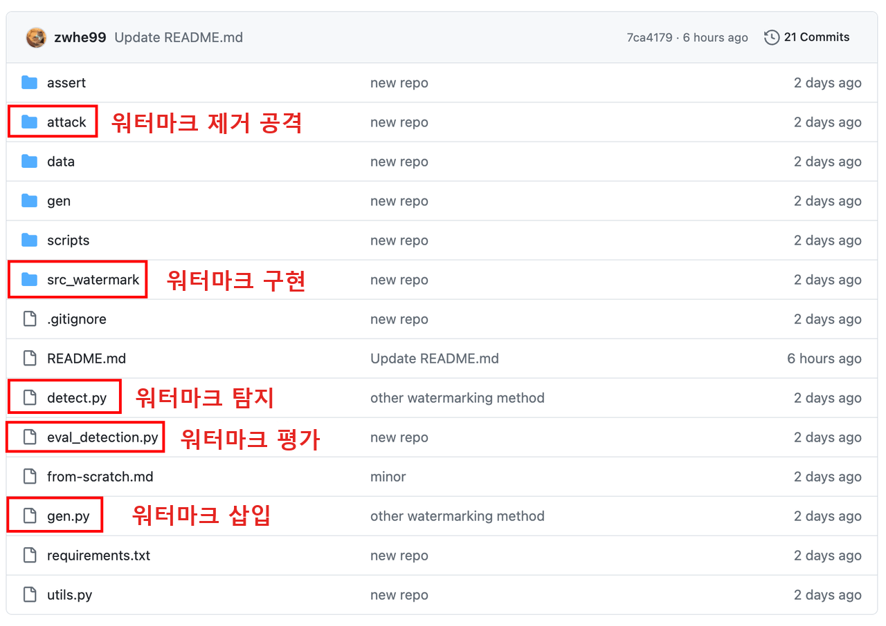

# 실습으로 배우는 대규모 모델: 모델 워터마킹

안내: 이 섹션에서는 언어 모델의 워터마킹을 소개합니다.

> 언어 모델이 생성한 콘텐츠에 인간은 인지할 수 없지만 알고리즘으로는 탐지할 수 있는 "워터마크"를 삽입합니다.

## 본 튜토리얼 목표

1. 워터마크 삽입: 언어 모델이 콘텐츠를 생성할 때 워터마크 삽입
2. 워터마크 탐지: 주어진 텍스트의 워터마크 강도 탐지
3. 워터마크 평가: 워터마크 방법의 탐지 성능 평가
4. 워터마크의 강건성(Robustness) 평가 (선택 사항)


## 사전 준비

### 2.1 X-SIR 코드 저장소 알아보기

https://github.com/zwhe99/X-SIR

X-SIR 저장소는 다음 내용의 구현을 포함하고 있습니다.

- 세 가지 텍스트 워터마크 알고리즘: X-SIR, SIR, KGW
- 두 가지 워터마크 제거 공격 방법: paraphrase 및 translation



### 2.2 환경 준비

```Shell
git clone https://github.com/zwhe99/X-SIR && cd X-SIR
conda create -n xsir python==3.10.10
conda activate xsir
pip3 install -r requirements.txt
# [optional] pip3 install flash-attn==2.3.3
```

> requirements.txt에 기재된 버전은 모두 권장 버전이며 필수 사항은 아닙니다.


## 실습 예제

> KGW 알고리즘을 사용하여 언어 모델이 생성한 콘텐츠에 워터마크 삽입하기

### 3.1 데이터 준비

언어 모델에 입력할 프롬프트(prompt)를 jsonl 파일로 구성합니다:

```JSON
{"prompt": "Ghost of Emmett Till: Based on Real Life Events "}
{"prompt": "Antique Cambridge Glass Pink Decagon Console Bowl Engraved Gold Highlights\n"}
{"prompt": "2009 > Information And Communication Technology Index statistics - Countries "}
......
```

- 각 줄은 하나의 json 객체(object)이며, 최소한 "prompt"라는 이름의 키를 포함해야 합니다.
- 이후 내용은 `data/dataset/mc4/mc4.en.jsonl` 파일을 예시로 사용합니다. 이 파일은 총 500개의 데이터를 포함하고 있으며, 모델 처리 시간이 너무 길다고 느껴지면 데이터를 직접 줄여서 사용할 수 있습니다.

### 3.2 워터마크 삽입

- 모델과 워터마크 알고리즘을 선택합니다. 여기서는 `baichuan-inc/Baichuan-7B` 모델과 `KGW` 워터마크 알고리즘을 선택합니다.

  - ```Shell
    MODEL_NAME=baichuan-inc/Baichuan-7B
    MODEL_ABBR=baichuan-7b
    WATERMARK_METHOD_FLAG="--watermark_method kgw"
    ```

- 콘텐츠를 생성하고 워터마크를 삽입합니다.

  - ```Shell
    python3 gen.py \
        --base_model $MODEL_NAME \
        --fp16 \
        --batch_size 32 \
        --input_file data/dataset/mc4/mc4.en.jsonl \
        --output_file gen/$MODEL_ABBR/kgw/mc4.en.mod.jsonl \
        $WATERMARK_METHOD_FLAG
    ```

  - 이 명령은 모델이 생성한 콘텐츠를 출력 파일(`gen/$MODEL_ABBR/kgw/mc4.en.mod.jsonl`)에 저장합니다.

  - 출력 파일의 형식은 다음과 같으며, 여기서 response는 모델의 출력 내용입니다:

    - ```JSON
      {"prompt": "Ghost of Emmett Till: Based on Real Life Events ", "response": ".In August if 1955 African American Emmett Louis Till (21)\nThe second part of The Man From Waco, about Dan Millers trial for murdering his friend Michael Capps in a Texas wiener wrastle as I believe the statute says called it then; back at that time that would have surely occurred since Dan kept his pistol in one of those watery doggy bags he keeps around to clean himself with after emptying can into a nearby lake just minutes before committing his crime. If what we read is true thats exactly where Dan left his stolen gun and later used it in the robbery gone wrong which killed two innocent boys when his own accomplice got into an argument over not being paid enough therefore wanting out. This angered Miller whos history of mental instability could be taken one way or another but this criminal act was unavoidable once they entered FBIs hands and some other very powerful law officers who were involved either directly"}
      {"prompt": "Antique Cambridge Glass Pink Decagon Console Bowl Engraved Gold Highlights\n", "response": "An exceptionally fine decorative antique pink decagonal glass side bowl is the perfect example of early art and innovation . Fully engraved, this beautiful English vintage tableware piece exhibits a great degree on craftsmanship! Made in England during the mid 1800's it features three sets of concentric ribbons on the exterior to elegantly highlight an intricate, deep reddish color which evokes warmth and comfort for years to come! This historically significant vase has been featured within numerous museum exhibitions including \"Glass at The Corning Museum\" ; \"The First Half Century\" & a special travelling exhibit called:\" Sight Of Glass: British Cut Glass\" by ibex limited (retailer) as well as \"SIGNALS - Celebrating History In American Silver Through The Articulated Bottle Vessel\" presented at the Corning Museum of Glass 2012 ASA national symposium! We provide our customers with quality phot"}
      {"prompt": "2009 > Information And Communication Technology Index statistics - Countries ", "response": "5/22/2016\nAnnual change of mobile telephone subscriptions in Armenia (per 1 population). 2.2% increase is equivalent to 38 subscriptions per 100 people. Density rank: 121 out of 222.\nCyclist(s)/month(S). Likes bike riding? Take advantage of discount and cheap rental bikes at Rimon Bike Rentals in Yerevan! No advance payments or additional deposits are required. They have a good range of bicycles, including mountainbikes. More on their Facebook page \nYou must know about electric cars. The Renault Fluence KZERO gets it right in the city but I'm not sure what mileage you can expect from it. Still its fun project http://www.renault-kzen.com\nFor more on this and related issues : Armenian Institute for Electronic Governance reports |"}
      ......
      ```


### 3.3 워터마크 탐지

> 워터마크 탐지란 주어진 텍스트에 대해 해당 텍스트의 워터마크 강도(z-score)를 계산하는 것입니다.

- **워터마크가 있는** 텍스트의 워터마크 강도 계산

  - ```python
    python3 detect.py \
        --base_model $MODEL_NAME \
        --detect_file gen/$MODEL_ABBR/kgw/mc4.en.mod.jsonl \
        --output_file gen/$MODEL_ABBR/kgw/mc4.en.mod.z_score.jsonl \
        $WATERMARK_METHOD_FLAG
    ```

- **워터마크가 없는** 텍스트의 워터마크 강도 계산

  - ```python
    python3 detect.py \
        --base_model $MODEL_NAME \
        --detect_file data/dataset/mc4/mc4.en.jsonl \
        --output_file gen/$MODEL_ABBR/kgw/mc4.en.hum.z_score.jsonl \
        $WATERMARK_METHOD_FLAG
    ```

- 출력 파일 형식은 다음과 같습니다:

  - ```JSON
    {"z_score": 12.105422509165574, "prompt": "Ghost of Emmett Till: Based on Real Life Events ", "response": ".In August if 1955 African American Emmett Louis Till (21)\nThe second part of The Man From Waco, about Dan Millers trial for murdering his friend Michael Capps in a Texas wiener wrastle as I believe the statute says called it then; back at that time that would have surely occurred since Dan kept his pistol in one of those watery doggy bags he keeps around to clean himself with after emptying can into a nearby lake just minutes before committing his crime. If what we read is true thats exactly where Dan left his stolen gun and later used it in the robbery gone wrong which killed two innocent boys when his own accomplice got into an argument over not being paid enough therefore wanting out. This angered Miller whos history of mental instability could be taken one way or another but this criminal act was unavoidable once they entered FBIs hands and some other very powerful law officers who were involved either directly", "biases": null}
    {"z_score": 12.990684249887122, "prompt": "Antique Cambridge Glass Pink Decagon Console Bowl Engraved Gold Highlights\n", "response": "An exceptionally fine decorative antique pink decagonal glass side bowl is the perfect example of early art and innovation . Fully engraved, this beautiful English vintage tableware piece exhibits a great degree on craftsmanship! Made in England during the mid 1800's it features three sets of concentric ribbons on the exterior to elegantly highlight an intricate, deep reddish color which evokes warmth and comfort for years to come! This historically significant vase has been featured within numerous museum exhibitions including \"Glass at The Corning Museum\" ; \"The First Half Century\" & a special travelling exhibit called:\" Sight Of Glass: British Cut Glass\" by ibex limited (retailer) as well as \"SIGNALS - Celebrating History In American Silver Through The Articulated Bottle Vessel\" presented at the Corning Museum of Glass 2012 ASA national symposium! We provide our customers with quality phot", "biases": null}
    {"z_score": 11.455466938203664, "prompt": "2009 > Information And Communication Technology Index statistics - Countries ", "response": "5/22/2016\nAnnual change of mobile telephone subscriptions in Armenia (per 1 population). 2.2% increase is equivalent to 38 subscriptions per 100 people. Density rank: 121 out of 222.\nCyclist(s)/month(S). Likes bike riding? Take advantage of discount and cheap rental bikes at Rimon Bike Rentals in Yerevan! No advance payments or additional deposits are required. They have a good range of bicycles, including mountainbikes. More on their Facebook page \nYou must know about electric cars. The Renault Fluence KZERO gets it right in the city but I'm not sure what mileage you can expect from it. Still its fun project http://www.renault-kzen.com\nFor more on this and related issues : Armenian Institute for Electronic Governance reports |", "biases": null}
    ......
    ```

- 두 파일의 워터마크 강도 차이를 직접 확인해 보세요.

### 3.4 워터마크 평가
<a name="eval"></a>

- 워터마크 탐지 z-score 파일을 입력하여 탐지 정확도를 계산하고 ROC 곡선을 그립니다.

  - ```Shell
    python3 eval_detection.py \
            --hm_zscore gen/$MODEL_ABBR/kgw/mc4.en.hum.z_score.jsonl \
            --wm_zscore gen/$MODEL_ABBR/kgw/mc4.en.mod.z_score.jsonl \
            --roc_curve roc
    
    AUC: 1.000
    
    TPR@FPR=0.1: 0.998
    TPR@FPR=0.01: 0.998
    
    F1@FPR=0.1: 0.999
    F1@FPR=0.01: 0.999
    ```


## 워터마크의 강건성 평가 (선택 사항)

> 워터마크 텍스트에 paraphrase 및 translation 공격을 수행한 후 탐지 효과를 재평가합니다.

### 4.1 사전 준비

gpt-3.5-turbo-1106 모델을 사용하여 워터마크 텍스트에 대해 paraphrase 및 translation을 수행합니다. 다른 도구를 직접 선택하여 사용할 수도 있습니다.

- OpenAI의 API 키 설정

  - ```Shell
    export OPENAI_API_KEY=xxxx
    ```

- `attack/const.py`의 RPM (requests per min) 및 TPM (tokens per min) 수정

### 4.2 공격 수행 (번역을 예시로)

- 워터마크 텍스트를 중국어로 번역

  - ```Shell
    python3 attack/translate.py \
        --input_file gen/$MODEL_ABBR/kgw/mc4.en.mod.jsonl \
        --output_file gen/$MODEL_ABBR/kgw/mc4.en-zh.mod.jsonl \
        --model gpt-3.5-turbo-1106 \
        --src_lang en \
        --tgt_lang zh
    ```

- 재평가

  - [3.4](#eval) 참조

- 공격 전후의 워터마크 성능 변화 비교


## 심화 연습

- [X-SIR](https://github.com/zwhe99/X-SIR) 문서를 확인하여 다른 두 가지(X-SIR, SIR) 알고리즘의 사용법을 익히고, 다양한 공격 방법 하에서의 성능을 평가해 보세요.