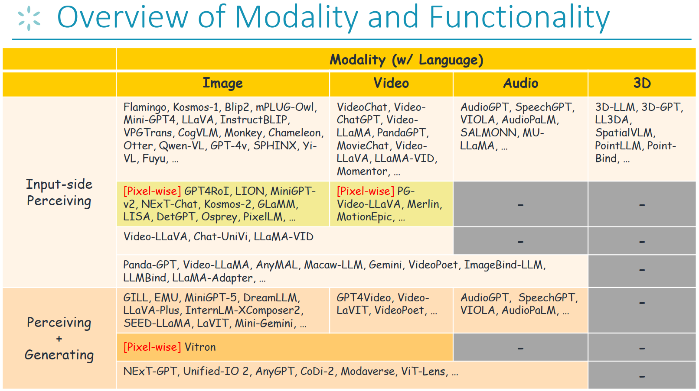
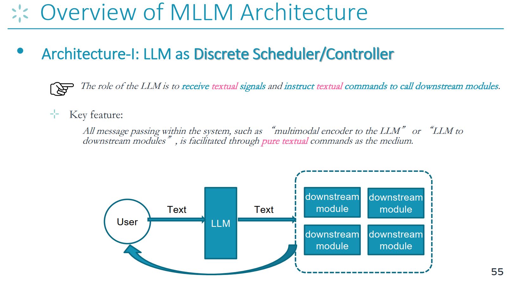
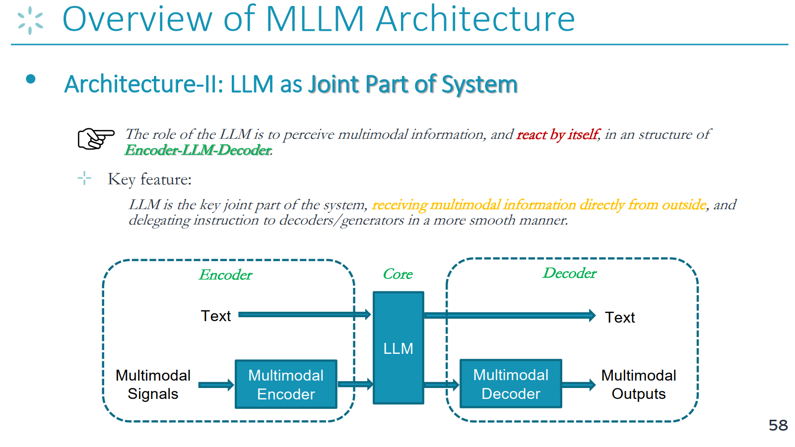
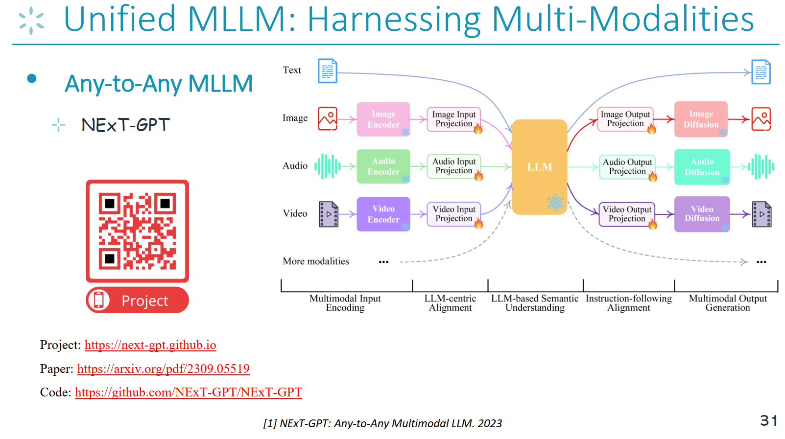
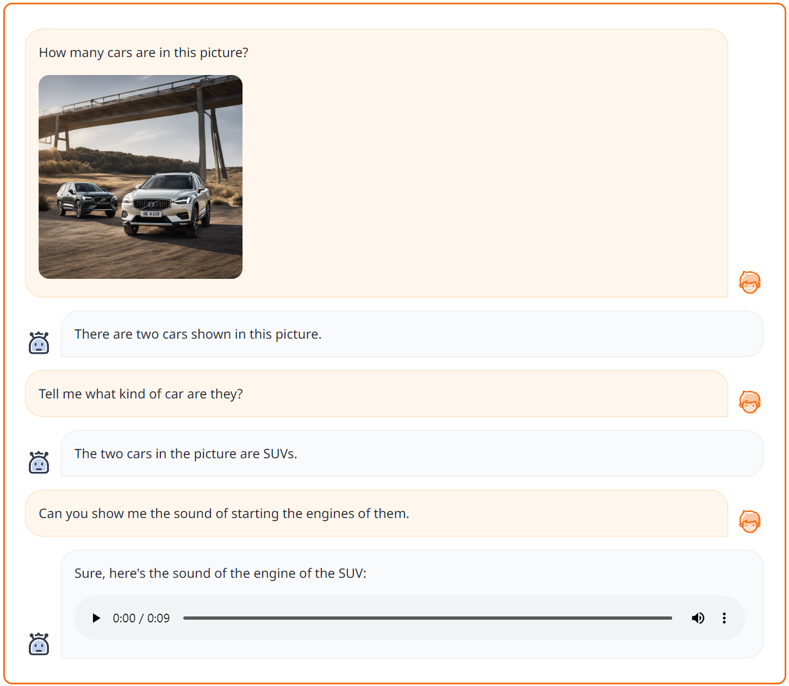
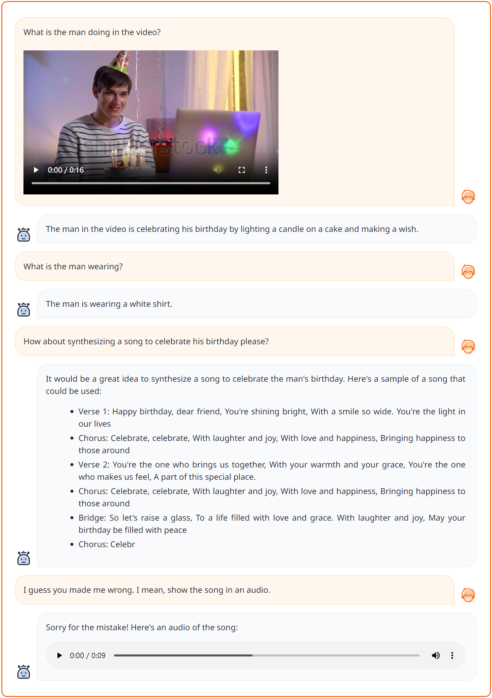
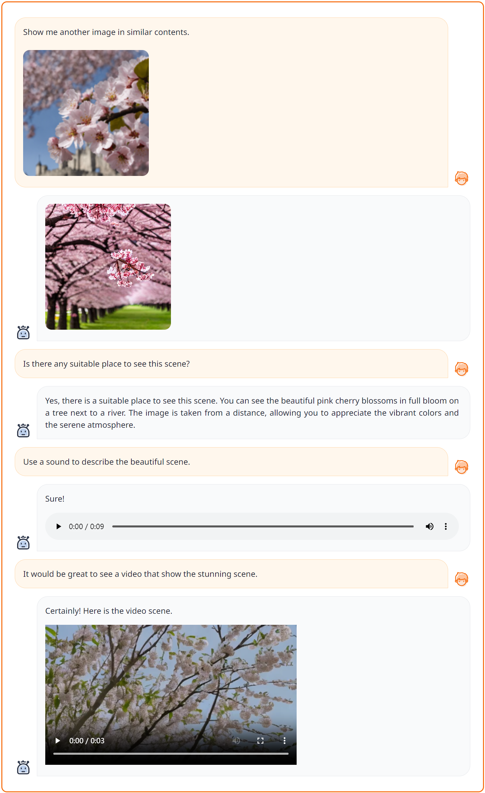
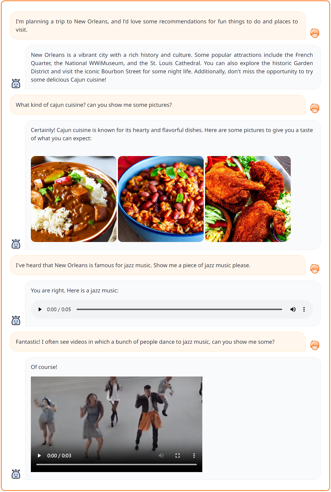

# 실습으로 배우는 대규모 모델: 멀티모달 대규모 언어 모델

안내: 이 섹션에서는 멀티모달 대규모 언어 모델의 주요 아키텍처와 구축 방법을 소개합니다.

> 대규모 언어 모델의 등장은 고차원적 지능이 언어 모달리티에서 충분히 발현될 수 있음을 보여주었습니다. 현실 세계를 더욱 충실하게 시뮬레이션할 수 있는 멀티모달 대규모 언어 모델은 어떻게 더 강력한 멀티모달 이해 및 생성 능력을 구현할까요? 멀티모달 대규모 언어 모델은 AGI 실현에 도움을 줄 수 있을까요?


## 본 튜토리얼 목표

1. 멀티모달 대규모 언어 모델의 유형 익히기
2. 멀티모달 대규모 언어 모델의 범용 기술 프레임워크 파악하기
3. 멀티모달 대규모 언어 모델의 구축, 학습 및 추론 마스터하기


## 1. 이론 지식 준비


### 1.1 멀티모달 대규모 언어 모델의 유형 알아보기

- 기존 멀티모달 대규모 언어 모델의 기능 및 모달리티 지원 분류


> 멀티모달 대규모 언어 모델(MLLM)을 구축하기 전에 이 분야의 연구자들은 하나의 공감대이자 핵심 전제에 도달했습니다. 스케일링 법칙(Scaling Law)과 창발적 현상(Emergent Phenomena) 덕분에 현재의 언어 기반 LLM은 이미 강력한 의미론적 이해 능력을 갖추고 있으며, 이는 언어가 지능을 담는 핵심 모달리티가 되었음을 의미하므로 언어 지능이 멀티모달 지능의 허브로 간주된다는 것입니다. 따라서 거의 모든 MLLM은 언어 기반 LLM 위에 구축되며, LLM은 두뇌나 중앙처리장치(CPU)와 유사한 핵심 의사결정 모듈 역할을 합니다. 다시 말해, 외부의 비텍스트 모달리티 모듈이나 인코더를 추가로 결합함으로써 LLM에 멀티모달 인식/작동 능력이 부여됩니다.

기존 MLLM을 모달리티 지원 및 기능 지원 현황에 따라 다양한 유형으로 분류합니다.




- 전체 튜토리얼 읽기: [[강의자료 (Slides)](https://github.com/Lordog/dive-into-llms/blob/main/documents/chapter8/mllms.pdf)] 


- 관련 서베이 논문 더 보기
    - [A Survey on Multimodal Large Language Models, https://github.com/BradyFU/Awesome-Multimodal-Large-Language-Models, 2023](https://github.com/BradyFU/Awesome-Multimodal-Large-Language-Models)
    - [MM-LLMs: Recent Advances in MultiModal Large Language Models, 2023](https://arxiv.org/pdf/2401.13601)


### 1.2 멀티모달 대규모 언어 모델의 범용 기술 프레임워크 알아보기


- 아키텍처 1: LLM as Task Scheduler

> 현재 학계 및 커뮤니티에는 두 가지 일반적인 MLLM 아키텍처가 존재합니다.
첫 번째는 "이산 스케줄러/컨트롤러로서의 LLM" 아키텍처입니다. 아래 그림과 같이 LLM의 역할은 텍스트 신호를 수신하고 다운스트림 모듈에 텍스트 명령을 내리는 것입니다. 시스템 내부의 모든 메시지 전달은 LLM이 출력하는 순수 텍스트 명령을 매개로 이루어집니다. 서로 다른 기능 모듈 간에는 직접적인 상호작용이 존재하지 않습니다.




- 아키텍처 2: LLM as Joint Part of System

> 두 번째 아키텍처는 인코더-LLM-디코더 프레임워크입니다.
이는 현재 가장 널리 쓰이는 아키텍처이기도 합니다. 여기서 LLM의 역할은 멀티모달 정보를 인식하고, 인코더-LLM-디코더 구조 내에서 직접 응답하고 작업을 수행하는 것입니다. 따라서 이 아키텍처와 첫 번째 아키텍처의 핵심 차이점은 LLM이 시스템의 핵심 결합 요소로서 외부로부터 직접 멀티모달 정보를 수신하고 보다 매끄러운 방식으로 디코더/생성기에 명령을 위임한다는 점입니다. 아래 그림과 같이 인코더-LLM-디코더 프레임워크에서 인코더는 여러 모달리티에서 온 인코딩 신호를 처리하고, LLM은 핵심 의사결정자 역할을 하며, 디코더는 멀티모달 출력을 관리합니다.




## 2. 범용 멀티모달 대규모 언어 모델 실습

> "임의 모달리티에서 임의 모달리티로(Any-to-Any)" 변환하는 범용 멀티모달 대규모 언어 모델의 구축 과정 실습


### 2.1 범용 통합 "Any-to-Any 모달리티" 멀티모달 대규모 언어 모델: NExT-GPT

> 향후 MLLM 연구는 분명 점점 더 범용적인 제너럴리스트(generalist) 방향으로 발전할 것이므로 가능한 한 많은 모달리티와 기능을 포함하게 될 것입니다. NExT-GPT는 이 분야에서 현재 가장 선구적인 연구 중 하나로, 최초로 "임의 모달리티에서 임의 모달리티로(Any-to-Any)"라는 MLLM 개념을 도입했습니다. 이러한 아키텍처는 강력한 기능을 구현하며 미래 멀티모달 대규모 언어 모델의 연구 방향에 기초를 다졌습니다.




> 본 강의의 멀티모달 대규모 언어 모델 코드 실습 파트에서는 NExT-GPT 코드를 대상으로 알기 쉽게 분석하고 실습을 진행합니다.

[NExT-GPT Project](https://next-gpt.github.io/)

[NExT-GPT GitHub 저장소](https://github.com/NExT-GPT/NExT-GPT)


### 2.2 코드 프레임워크 살펴보기


```
├── figures
├── data
│   ├── T-X_pair_data  
│   │   ├── audiocap                      # text-autio pairs data
│   │   │   ├── audios                    # audio files
│   │   │   └── audiocap.json             # the audio captions
│   │   ├── cc3m                          # text-image paris data
│   │   │   ├── images                    # image files
│   │   │   └── cc3m.json                 # the image captions
│   │   └── webvid                        # text-video pairs data
│   │   │   ├── videos                    # video files
│   │   │   └── webvid.json               # the video captions
│   ├── IT_data                           # instruction data
│   │   ├── T+X-T_data                    # text+[image/audio/video] to text instruction data
│   │   │   ├── alpaca                    # textual instruction data
│   │   │   ├── llava                     # visual instruction data
│   │   ├── T-T+X                         # synthesized text to text+[image/audio/video] instruction data
│   │   └── MosIT                         # Modality-switching Instruction Tuning instruction data
├── code
│   ├── config
│   │   ├── base.yaml                     # the model configuration 
│   │   ├── stage_1.yaml                  # enc-side alignment training configuration
│   │   ├── stage_2.yaml                  # dec-side alignment training configuration
│   │   └── stage_3.yaml                  # instruction-tuning configuration
│   ├── dsconfig
│   │   ├── stage_1.json                  # deepspeed configuration for enc-side alignment training
│   │   ├── stage_2.json                  # deepspeed configuration for dec-side alignment training
│   │   └── stage_3.json                  # deepspeed configuration for instruction-tuning training
│   ├── datast
│   │   ├── base_dataset.py
│   │   ├── catalog.py                    # the catalog information of the dataset
│   │   ├── cc3m_datast.py                # process and load text-image pair dataset
│   │   ├── audiocap_datast.py            # process and load text-audio pair dataset
│   │   ├── webvid_dataset.py             # process and load text-video pair dataset
│   │   ├── T+X-T_instruction_dataset.py  # process and load text+x-to-text instruction dataset
│   │   ├── T-T+X_instruction_dataset.py  # process and load text-to-text+x instruction dataset
│   │   └── concat_dataset.py             # process and load multiple dataset
│   ├── model                     
│   │   ├── ImageBind                     # the code from ImageBind Model
│   │   ├── common
│   │   ├── anyToImageVideoAudio.py       # the main model file
│   │   ├── agent.py
│   │   ├── modeling_llama.py
│   │   ├── custom_ad.py                  # the audio diffusion 
│   │   ├── custom_sd.py                  # the image diffusion
│   │   ├── custom_vd.py                  # the video diffusion
│   │   ├── layers.py                     # the output projection layers
│   │   └── ...  
│   ├── scripts
│   │   ├── train.sh                      # training NExT-GPT script
│   │   └── app.sh                        # deploying demo script
│   ├── header.py
│   ├── process_embeddings.py             # precompute the captions embeddings
│   ├── train.py                          # training
│   ├── inference.py                      # inference
│   ├── demo_app.py                       # deploy Gradio demonstration 
│   └── ...
├── ckpt                           
│   ├── delta_ckpt                        # tunable NExT-GPT params
│   │   ├── nextgpt         
│   │   │   ├── 7b_tiva_v0                # the directory to save the log file
│   │   │   │   ├── log                   # the logs
│   └── ...       
│   ├── pretrained_ckpt                   # frozen params of pretrained modules
│   │   ├── imagebind_ckpt
│   │   │   ├──huge                       # version
│   │   │   │   └──imagebind_huge.pth
│   │   ├── vicuna_ckpt
│   │   │   ├── 7b_v0                     # version
│   │   │   │   ├── config.json
│   │   │   │   ├── pytorch_model-00001-of-00002.bin
│   │   │   │   ├── tokenizer.model
│   │   │   │   └── ...
├── LICENCE.md
├── README.md
└── requirements.txt
```


### 2.3 환경 설치

먼저 저장소를 클론하고 필요한 환경을 설치해 주세요. 다음 명령어를 실행하여 환경 설치를 완료할 수 있습니다:

```
conda env create -n nextgpt python=3.8

conda activate nextgpt

# CUDA 11.6
conda install pytorch==1.13.1 torchvision==0.14.1 torchaudio==0.13.1 pytorch-cuda=11.6 -c pytorch -c nvidia

git clone https://github.com/NExT-GPT/NExT-GPT.git
cd NExT-GPT

pip install -r requirements.txt
```


### 2.4 시스템 추론 실습


#### 2.4.1 사전학습된 NExT-GPT 모델 체크포인트 로드

- **1단계**: `동결 파라미터(Frozen Parameters)` 로드. [NExT-GPT](https://github.com/NExT-GPT/NExT-GPT)는 다음의 기존 모델 또는 모듈을 기반으로 학습되었으므로, 아래 안내에 따라 체크포인트를 준비해 주세요.
    - `ImageBind`는 통합 이미지/비디오/오디오 인코더입니다. [여기](https://dl.fbaipublicfiles.com/imagebind/imagebind_huge.pth)에서 버전이 `huge`인 사전학습 체크포인트를 다운로드할 수 있습니다. 그런 다음 `imagebind_huge.pth` 파일을 `ckpt/pretrained_ckpt/imagebind_ckpt/huge`에 배치합니다.
    - `Vicuna`: 먼저 [여기](https://github.com/NExT-GPT/NExT-GPT/blob/main/NExT-GPT-Lagacy/ckpt/pretrained_ckpt/prepare_vicuna.md)의 안내에 따라 LLaMA를 준비합니다. 그런 다음 사전학습 모델을 `ckpt/pretrained_ckpt/vicuna_ckpt/`에 배치합니다.
    - `Image Diffusion`은 이미지 생성에 사용됩니다. NExT-GPT는 버전이 `v1-5`인 [Stable Diffusion](https://huggingface.co/runwayml/stable-diffusion-v1-5)을 사용합니다. (_코드 내에서 자동으로 다운로드됩니다_)
    - `Audio Diffusion`은 오디오 콘텐츠 생성에 사용됩니다. NExT-GPT는 버전이 `l-full`인 [AudioLDM](https://github.com/haoheliu/AudioLDM)을 사용합니다. (_코드 내에서 자동으로 다운로드됩니다_)
    - `Video Diffusion`은 비디오 생성에 사용됩니다. 버전이 `v2_576w`인 [ZeroScope](https://huggingface.co/cerspense/zeroscope_v2_576w)를 사용합니다. (_코드 내에서 자동으로 다운로드됩니다_)

- **2단계**: `학습 가능 파라미터(Tunable Parameters)` 로드.

NExT-GPT 시스템을 `ckpt/delta_ckpt/nextgpt/7b_tiva_v0`에 배치합니다. 1) 직접 학습한 파라미터를 사용하거나, 2) [Huggingface](https://huggingface.co/ChocoWu/nextgpt_7b_tiva_v0)에서 사전학습된 체크포인트를 다운로드할 수 있습니다.


#### 2.4.2 Gradio 데모 배포

체크포인트 로드를 완료한 후 다음 방법으로 로컬에서 데모를 실행할 수 있습니다:
```angular2html
cd ./code
bash scripts/app.sh
```
지정할 주요 파라미터는 다음과 같습니다:
- `--nextgpt_ckpt_path`: 사전학습된 NExT-GPT 파라미터의 경로.


#### 2.4.3 테스트 예제 실습

현재 버전은 텍스트, 이미지, 비디오, 오디오 네 가지 모달리티의 임의 조합 입력을 지원하며, 작업에 따른 조합된 모달리티 출력을 생성합니다.
또한 다중 턴 컨텍스트 상호작용을 지원합니다.

직접 실행하여 테스트 결과를 확인해 보세요.

- **Case-1**: 입력 T+I, 출력 T+A




- **Case-2**: 입력 T+V, 출력 T+A




- **Case-3**: 입력 T+I, 출력 T+I+V




- **Case-4**: 입력 T, 출력 T+I+V+A




### 2.5 시스템 학습 과정


#### 2.5.1 데이터 준비

모델 학습에 사용되는 다음 데이터셋을 다운로드해 주세요:

A) T-X 쌍(pair) 데이터
  - ***텍스트-이미지*** 쌍인 `CC3M` 데이터는 이 안내`data/T-X_pair_data/cc3m/prepare.md`에 따라 진행해 주세요. 그런 다음 데이터를 `data/T-X_pair_data/cc3m`에 배치합니다.
  - ***텍스트-비디오*** 쌍인 `WebVid` 데이터는 `data/T-X_pair_data/webvid/prepare.md`을 참조하세요. 파일은 `data/T-X_pair_data/webvid`에 저장해야 합니다.
  - ***텍스트-오디오*** 쌍인 `AudioCap` 데이터는 `data/T-X_pair_data/audiocap/prepare.md`을 참조하세요. 데이터를 `data/T-X_pair_data/audiocap`에 저장합니다.

B) 명령어 파인튜닝(Instruction Tuning) 데이터
  - T+X-T
    - ***비전 명령어 데이터*** (from `LLaVA`)를 [여기](https://github.com/haotian-liu/LLaVA/blob/main/docs/Data.md)에서 다운로드하여 `data/IT_data/T+X-T_data/llava/`에 배치합니다.
    - ***텍스트 명령어 데이터*** (from `Alpaca`)를 [여기](https://github.com/tatsu-lab/stanford_alpaca)에서 다운로드하여 `data/IT_data/T+X-T_data/alpaca/`에 배치합니다.
    - ***비디오 명령어 데이터*** (from `VideoChat`)를 [여기](https://github.com/OpenGVLab/InternVideo/tree/main/Data/instruction_data)에서 다운로드하여 `data/IT_data/T+X-T_data/videochat/`에 배치합니다.

    참고: 데이터셋을 다운로드한 후 `preprocess_dataset.py`를 실행하여 데이터셋 형식이 통일되도록 전처리해 주세요.
  - T-X+T (T2M)
    - `T-X+T` 명령어 데이터셋(T2M)은 `data/IT_data/T-T+X_data`에 저장합니다.
   
  - MosIT
    - NExT-GPT 저장소의 안내를 확인하여 `data/IT_data/MosIT_data/` 디렉터리에 배치합니다.


#### 2.5.2 임베딩 벡터 준비

NExT-GPT 디코딩단의 정렬(alignment) 학습에서는 Signal Token과 캡션(captions) 표현 간의 거리를 최소화합니다. 시스템의 높은 효율성을 보장하고 시간 및 메모리 비용을 절약하기 위해 각 확산(Diffusion) 모델의 텍스트 인코더를 사용하여 이미지, 오디오 및 비디오 캡션의 텍스트 임베딩을 사전 계산합니다.

NExT-GPT 학습을 진행하기 전에 다음 명령어를 실행해 주세요. 생성된 `embedding` 파일은 `data/embed`에 저장됩니다.
```
cd ./code/
python process_embeddings.py ../data/T-X_pair_data/cc3m/cc3m.json image ../data/embed/ runwayml/stable-diffusion-v1-5
```


파라미터 설명:
- args[1]: 캡션 파일 경로;
- args[2]: 모달리티 (`image`, `video`, `audio` 가능);
- args[3]: 임베딩 벡터 파일 저장 경로;
- args[4]: 해당 사전학습 확산 모델 이름.


#### 2.5.3 3단계 학습


먼저 기본 설정 파일인 `code/config/base.yaml`을 참조하여 전체 모듈의 기본 시스템 설정을 파악합니다.

그런 다음 아래 스크립트를 실행하여 NExT-GPT 학습을 시작합니다:
```
cd ./code
bash scripts/train.sh
```

지정 명령어는 다음과 같습니다:
```
deepspeed --include localhost:0 --master_addr 127.0.0.1 --master_port 28459 train.py \
    --model nextgpt \
    --stage 1\
    --save_path  ../ckpt/delta_ckpt/nextgpt/7b_tiva_v0/\
    --log_path ../ckpt/delta_ckpt/nextgpt/7b_tiva_v0/log/
```
주요 파라미터:
- `--include`: `localhost:0`은 DeepSpeed에서의 GPU CUDA 번호 `0`을 나타냅니다.
- `--stage`: 학습 단계.
- `--save_path`: 학습 후의 delta 가중치를 저장할 디렉터리입니다. 이 디렉터리는 자동으로 생성됩니다.
- `--log_path`: 로그 파일을 저장할 디렉터리입니다.


NExT-GPT의 전체 학습은 3단계로 나뉩니다:

- **1단계**: 인코딩단 LLM 중심의 멀티모달 정렬. 이 단계에서는 ImageBind, LLM 및 출력 프로젝션 레이어를 동결한 상태에서 ***입력 프로젝션 레이어(Input Projection Layer)*** 를 학습합니다.
  
  위의 `train.sh` 스크립트에서 `--stage 1`로 설정하여 실행하면 됩니다.
  
  더 자세한 단계별 설정 정보는 실행 설정 파일 [code/config/stage_1.yaml](https://github.com/NExT-GPT/NExT-GPT/blob/main/NExT-GPT-Lagacy/code/config/stage_1.yaml)과 deepspeed 설정 파일 `code/dsconfig/stage_1.json`을 참조해 주세요.

  참고로 이 단계에서 사용되는 데이터셋은 `dataset_name_list`에 포함되며, 데이터셋 이름은 반드시 [code/dataset/catalog.py](https://github.com/NExT-GPT/NExT-GPT/blob/main/NExT-GPT-Lagacy/code/dataset/catalog.py)의 정의와 정확히 일치해야 합니다.


- **2단계**: 디코딩단 명령어 수행(Instruction-following) 정렬. 이 단계에서는 ImageBind, LLM 및 입력 프로젝션 레이어를 동결한 상태에서 ***출력 프로젝션 레이어(Output Projection Layer)*** 를 학습합니다.

  위의 `train.sh` 스크립트에서 `--stage 2`로 설정하여 실행하면 됩니다.

  더 자세한 단계별 설정 정보는 실행 설정 파일 `code/config/stage_2.yaml`과 deepspeed 설정 파일 `code/dsconfig/stage_2.json`을 참조해 주세요.


- **3단계**: 명령어 튜닝(Instruction Tuning). 이 단계에서는 명령어 데이터셋에 대해 1) LoRA를 통한 ***LLM*** 튜닝, 2) ***입력 프로젝션 레이어*** 튜닝, 3) ***출력 프로젝션 레이어*** 튜닝을 수행합니다.

  위의 `train.sh` 스크립트에서 `--stage 3`으로 설정하여 실행하면 됩니다.

  더 자세한 단계별 설정 정보는 실행 설정 파일 `code/config/stage_3.yaml`과 deepspeed 설정 파일 `code/dsconfig/stage_3.json`을 참조해 주세요.
